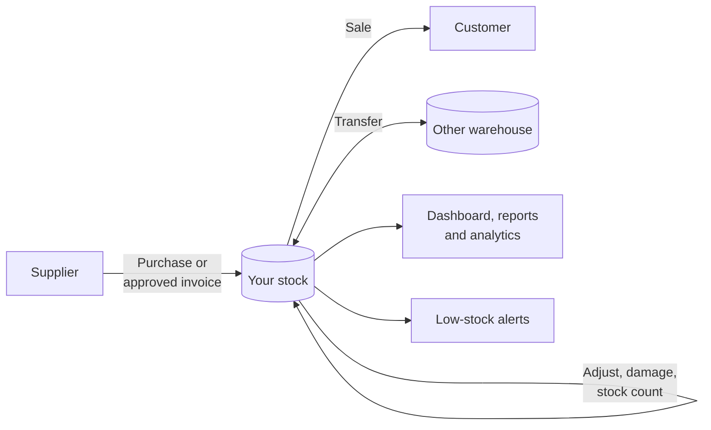
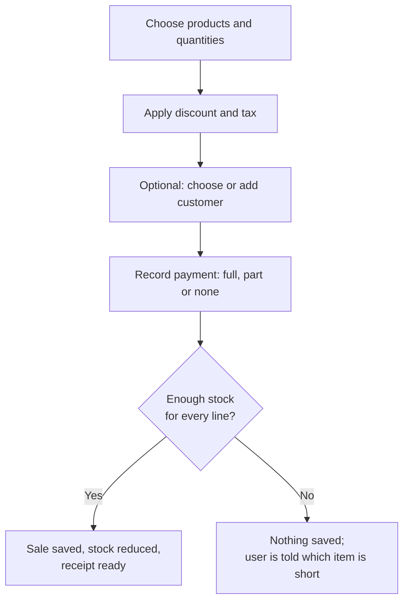
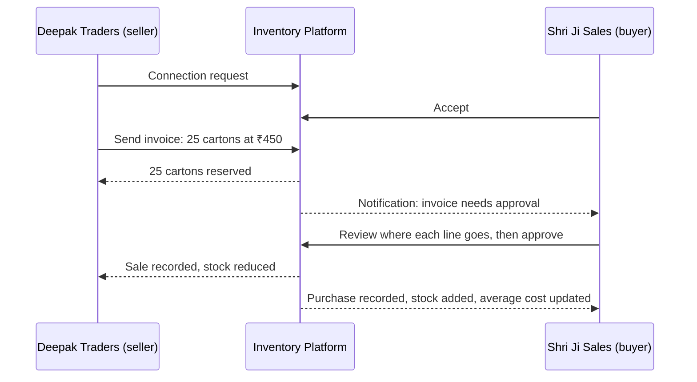
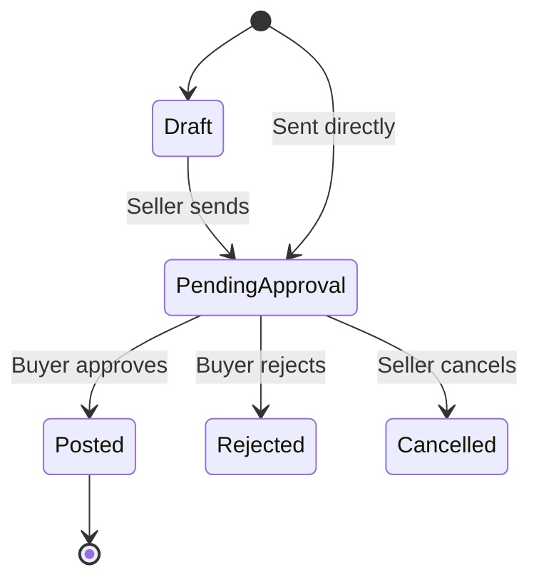
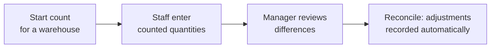
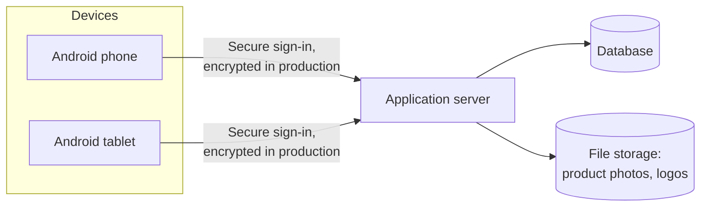

# Inventory Platform: Product Documentation

**Inventory, sales, purchases and business-to-business invoicing for growing businesses, on Android**

| | |
|---|---|
| Document type | Customer-facing product documentation |
| Product version | 2.0 (Android app) |
| Audience | Business owners, managers, prospective customers and project stakeholders |

---

## Contents

1. [Executive Summary](#1-executive-summary)
2. [Product Overview](#2-product-overview)
3. [Key Features](#3-key-features)
4. [How It Works](#4-how-it-works)
5. [User Guide](#5-user-guide)
6. [Business Benefits](#6-business-benefits)
7. [System Overview](#7-system-overview)
8. [Reports and Analytics](#8-reports-and-analytics)
9. [Security and Data Management](#9-security-and-data-management)
10. [Implementation and Deployment](#10-implementation-and-deployment)
11. [Limitations and Future Enhancements](#11-limitations-and-future-enhancements)
12. [Frequently Asked Questions](#12-frequently-asked-questions)
13. [Support and Maintenance](#13-support-and-maintenance)

---

## 1. Executive Summary

**Inventory Platform** is a mobile inventory and trading system for small and medium-sized businesses. A business owner and their team use an Android app to track every product they hold, record sales and purchases, see profit, and send invoices directly to other businesses on the platform.

The platform does not assume any particular trade. A pharmacy, a bookstore, a hardware shop, a bakery, a garment store or an electronics distributor can each set it up to match how they work. They define their own product categories, the details they record for each product, their units of measure, their warehouses and their team.

### Vision

Give every business, whatever its size or trade, a clear and reliable picture of its stock and its profit, without spreadsheets, paper registers or re-typing the same information twice.

### Objectives

| Objective | How the platform delivers it |
|---|---|
| Know exactly what is in stock | Live stock levels per product, size or variant, and warehouse, with a full history of every change |
| Stop running out of stock | Automatic low-stock and out-of-stock alerts, and a dashboard that highlights items needing attention |
| Understand profit | Every sale keeps its selling price and its cost, so profit and margin are accurate per product and over time |
| Work as a team, safely | Roles and permissions decide what each employee can see and do |
| Trade with other businesses without re-typing | A supplier's invoice, once approved by the buyer, updates both businesses' stock automatically |
| Keep working when the connection drops | Sales, purchases and stock changes can be recorded offline and are sent when the connection returns |

---

## 2. Product Overview

### Purpose

Inventory Platform replaces paper registers, spreadsheets and disconnected tools with one system that records stock, sales, purchases and payments together. Because these are linked, a sale reduces stock immediately, a purchase increases it and updates the product's cost, and reports always reflect what actually happened.

### Target customers

| Customer type | Typical use |
|---|---|
| Retail shops (pharmacy, grocery, hardware, books, garments, electronics) | Track stock, record counter sales with receipts, get low-stock alerts |
| Wholesalers and distributors | Manage stock across warehouses, invoice retailers, track what each customer owes |
| Small manufacturers and bakeries | Track materials in different units (kg, litres, pieces), batches and expiry dates |
| Multi-branch businesses | Keep separate stock per branch or warehouse and transfer between them |
| Business networks (supplier and retailer) | Send and approve invoices that update both sides' inventory |

### Business challenges addressed

| Challenge | Without the platform | With the platform |
|---|---|---|
| Stock mismatches | Counts on paper drift from reality; nobody knows who changed what | Every change is recorded with who, when, why, and the quantity before and after |
| Stock-outs and over-stocking | Problems are noticed only when a customer asks | Alerts and "needs attention" lists flag low and out-of-stock items early |
| Unknown profit | Profit is guessed from total sales | Profit is calculated from the actual cost of each item sold |
| Re-typing supplier invoices | Staff copy each supplier bill into the system by hand | Approving a supplier's invoice adds the goods to stock automatically |
| Unpaid sales | Credit given to customers is tracked in a notebook | Each sale shows paid, partly paid or unpaid, and the amount outstanding |
| Shared logins and misuse | Everyone uses the owner's account | Each person has their own login and only the permissions they need |

---

## 3. Key Features

### 3.1 Business workspace and setup

- **Self-service registration.** The owner registers the business and becomes its first administrator. The business is ready immediately, with common units (pieces, boxes, kilograms, litres, metres and so on) and a *Main Warehouse* already created.
- **Business profile.** Name, logo, contact details, address and tax registration number (for example GSTIN).
- **Business preferences.** Currency, time zone and default low-stock threshold, plus optional tracking that the owner switches on only if needed:

| Option | What it adds |
|---|---|
| Batch / lot tracking | Record the batch or lot number for stock received |
| Expiry dates | Record expiry dates per batch (useful for medicines and food) |
| Serial numbers | Track individual items by serial number (useful for electronics) |
| Damaged and reserved stock | Keep damaged or set-aside stock separate from stock that can be sold |
| Allow negative stock | Let stock go below zero (off by default) |
| Low-stock notifications | Turn low-stock alerts on or off |

- **More than one business.** One person can belong to several businesses and switch between them in the app. Each business's data stays completely separate.

### 3.2 Product catalogue

- **Categories and subcategories** in a tree, for example *Medicines → Tablets*. Categories can be archived when no longer needed.
- **Custom product fields.** Each business decides what information it records. A bookstore can add *Author* and *Publisher*. A pharmacy can add *Strength* and *Dosage form*. Supported field types are text, number, date, yes/no, dropdown and multi-select, and any field can be marked as required. Fields set on a category apply to its subcategories too.
- **Products** with name, category, unit, brand, model, SKU, barcode, description, photos and a minimum stock level.
- **Variants** such as size or colour. Each variant has its own SKU, barcode, stock and low-stock threshold.
- **Units and conversions.** Units can allow decimals (for example 2.5 kg). Conversions such as *1 box = 12 pieces* can be general or set for one product.
- **Pricing.** Purchase price, selling price and default tax rate per product. The product page shows the cost, profit per unit, margin, stock value and potential profit.
- **Search and filters.** Search by name, brand, SKU or barcode, and filter by category, stock status (in stock, low, out of stock) or archived products.

### 3.3 Stock management

| Operation | Purpose |
|---|---|
| Opening stock | Enter the starting quantity when a product is created |
| Add stock | Record goods coming in |
| Reduce stock | Record goods going out for reasons other than a sale (for example internal use) |
| Adjust | Correct the quantity to what is actually on the shelf. A reason is required. |
| Transfer | Move stock from one warehouse or branch to another |
| Mark damaged | Move stock into a separate damaged quantity |
| Reserve / release | Set stock aside so it cannot be sold, then release it later |

- **Stock cannot go negative** unless the business chooses to allow it.
- **Safe for busy teams.** When several people sell the same item at the same moment, the system processes the changes one at a time so it never sells more than is available. This is covered by automated tests.
- **Complete history.** Every stock change permanently records the type, quantity, quantity before and after, reason, notes, the person and the time. History entries cannot be edited or deleted.

### 3.4 Stock counts (stocktaking)

1. Start a count for a warehouse, either for everything or for one category. The system takes a snapshot of the expected quantities.
2. Staff enter the quantities they actually count.
3. A manager reviews the differences and reconciles. The system records an adjustment for each difference.

### 3.5 Warehouses and branches

- Any number of warehouses or branches, with one marked as the default.
- Storage locations (for example shelves or racks) can be listed within a warehouse.
- A warehouse can be archived once it holds no stock.

### 3.6 Sales

- **Multi-product sales** with per-line discount and tax, an optional customer, invoice number, and date and time.
- **Payment methods:** Cash, UPI, Card, Bank transfer and Credit.
- **Payment status:** Paid, Partly paid or Unpaid, with the outstanding amount shown. More payments can be added later.
- **Automatic stock update.** Stock is reduced as part of the same sale. If any item does not have enough stock, nothing is saved, so a sale is never half-recorded.
- **History is preserved.** Each sale keeps the price and cost that applied on that day. Changing a product's price later does not change past sales or past profit.
- **PDF receipts.** Every sale has an A4 receipt that can be opened, printed or shared (for example through WhatsApp or email on the phone).
- **Customers** are saved for repeat sales and can be searched by name or phone.

### 3.7 Returns and cancellations

- **Partial returns.** Return some items from a sale. Items in good condition go back into stock; damaged items are recorded without being restocked. A refund can be recorded, limited to the value returned and the money actually received.
- **Full cancellation.** Cancelling a sale restores all unreturned stock and records the refund. The original sale and its history are kept and marked *Cancelled*.

### 3.8 Purchases and suppliers

- Record goods received from a supplier, with cost, discount, tax, and optional batch, expiry or serial numbers.
- Stock is added automatically, and the product's **average cost** is updated, so profit stays accurate when buying prices change.
- Track payments made to suppliers (paid, partly paid, unpaid).
- A purchase can be cancelled, which removes the stock again. This is refused if some of that stock has already been sold.
- Supplier records are saved for reuse.

### 3.9 Business network and business-to-business invoices

Businesses on the platform can connect with each other and trade directly. For example, a wholesaler sends an invoice to a retailer. When the retailer approves it, **both inventories update automatically**, and the retailer does not re-type anything.

- **Connect.** Find another business by name, by its unique business code (for example `B7K3F9QA`), or by its exact phone number, and send a connection request. Search shows only the name, business type, city and code. A business can choose not to appear in search.
- **Send invoices (seller).** Choose a connected buyer, add products, quantities, prices, discounts and tax, then send the invoice or save it as a draft. Totals are always calculated by the system. Sending sets the goods aside in the seller's stock so they cannot be sold to someone else in the meantime.
- **Review and approve (buyer).** The buyer sees where each line will go in their own stock before approving:
  - a product the buyer linked before is used first;
  - otherwise a product with the same barcode;
  - otherwise a product with the same name, variant and unit, if exactly one matches;
  - if several match, the buyer chooses; if none matches, a new product is created with the supplier's details.
- **One step, both sides.** On approval, the seller's sale and the buyer's purchase are recorded together. Either both are saved or neither is. Approving twice has no extra effect.
- **Reject or cancel.** The buyer can reject with a reason, or the seller can cancel a pending invoice. In both cases the reserved stock is released.
- **Returns between businesses.** The buyer can request a return on an approved invoice. When the seller accepts, the goods leave the buyer's stock and return to the seller's.
- **Dashboard prompt.** The buyer's dashboard shows how many purchase invoices are waiting for approval.

### 3.10 Team, roles and permissions

Three standard roles are provided. The administrator can also grant or remove individual permissions for any person.

| Permission | Business Admin | Inventory Manager | Staff |
|---|:-:|:-:|:-:|
| View products and stock | ✓ | ✓ | ✓ |
| Create, edit and archive products | ✓ | ✓ | |
| Add and reduce stock | ✓ | ✓ | ✓ |
| Adjust stock, mark damaged or reserved | ✓ | ✓ | |
| Transfer stock between warehouses | ✓ | ✓ | |
| Run stock counts | ✓ | ✓ | ✓ (reconciling needs *Adjust*) |
| View and export reports | ✓ | ✓ | |
| Record sales, take payments, manage customers | ✓ | ✓ | ✓ |
| Cancel sales and record returns | ✓ | ✓ | |
| Record purchases and manage suppliers | ✓ | ✓ | |
| View sales, profit, analytics and purchase costs | ✓ | ✓ | |
| Manage categories, fields and units | ✓ | ✓ | |
| Manage warehouses | ✓ | ✓ | |
| Manage employees | ✓ | | |
| Business profile and settings | ✓ | | |

- **Invitations by code.** The administrator creates an invitation and shares its code (for example by messaging app). The new member enters the code in the app to join. Invitations are valid for 7 days.
- **Instant deactivation.** Deactivating a member signs them out immediately.
- **Staff see only what they need.** For example, staff without analytics permission do not see purchase costs or profit.

### 3.11 Notifications

- In-app alerts for **low stock**, **out of stock**, team events and business invoices.
- Repeated stock changes on the same item do not produce a flood of duplicate alerts.

### 3.12 Offline working

- **Recent data stays viewable** when the phone has no connection, so staff can still look up products and stock.
- **Changes can be recorded offline:** sales, purchases, sale payments, stock operations and transfers. They are saved on the phone and sent automatically when the connection returns.
- **No duplicates.** Each change carries a unique reference, so sending it again never records it twice.
- **Clear status.** A banner shows when the app is offline, and a *Pending sync* screen lists waiting changes. If the system refuses a change (for example because the stock has since been sold), it is marked with the reason so the user can retry or discard it.
- The app warns before signing out if changes are still waiting to be sent.

### 3.13 Backup and restore

- The administrator can save the business's data to a backup file on the phone.
- A backup file can be restored as a **new, separate copy** of the business (named "… (restored)"). The person restoring becomes its administrator. The original business is never overwritten.

### 3.14 Languages and appearance

- **Seven languages:** English, Hindi (हिन्दी), Bengali (বাংলা), Tamil (தமிழ்), Marathi (मराठी), Arabic (العربية) and Urdu (اردو), with right-to-left layout for Arabic and Urdu. The app can also follow the phone's language.
- **Light, dark or system theme.**
- **Phone and tablet layouts.** Phones use a bottom navigation bar; tablets use a side navigation rail.

---

## 4. How It Works

### 4.1 The big picture

Every arrow above is recorded in the stock history, so the reports and the shelf always agree.

### 4.2 Example: a pharmacy sets up and makes its first sale

*Sharma Medical Store* registers in the app.

1. The owner creates the category **Medicines**, with the subcategory **Tablets**, and adds custom fields **Strength** (text, required) and **Dosage form** (dropdown: Tablet, Syrup, Injection).
2. In *Business settings* they turn on **batch tracking** and **expiry dates**.
3. They add the product **Paracetamol 500 mg** in *Tablets*, unit *Strips*, with selling price ₹30, purchase price ₹20, minimum stock 20, and opening stock 100 strips from batch *L2401*, expiring June 2027.
4. A customer buys 7 strips and pays by UPI. Staff record the sale. Stock falls to 93, the receipt is shared with the customer, and the sale shows as *Paid*.
5. The owner opens *Analytics* that evening and sees today's sales of ₹210, cost of ₹140 and gross profit of ₹70 (tax excluded).

### 4.3 Recording a sale

### 4.4 Example: a wholesaler invoices a retailer

*Deepak Traders* (wholesaler) and *Shri Ji Sales* (retailer) are both on the platform.

If the buyer rejects instead, or the seller cancels, the reserved stock is released and no stock moves.

**Invoice stages**

### 4.5 Recording a purchase

1. Choose the supplier (or type a new one and save it).
2. Add products with the quantity received and the unit cost, plus batch, expiry or serial numbers if tracked.
3. Record any payment made.
4. Save. Stock increases and each product's average cost is updated.

**Average cost example.** You hold 50 units bought at ₹100. You receive 50 more at ₹110. The new average cost is ₹105, and future sales use ₹105 when calculating profit.

### 4.6 Stock count

---

## 5. User Guide

### 5.1 Navigating the app

The main sections are at the bottom of the screen (or at the side on a tablet):

| Section | What you find there |
|---|---|
| **Home** | Dashboard: stock totals, items needing attention, sales highlights, recent activity, invoices awaiting approval |
| **Products** | Product list, search, filters and product details |
| **Sales** | Sales list, new sale, payments, receipts and returns |
| **Analytics** | Two sections: *Sales analytics* (sales, profit, trends, insights) and *Stock reports* (inventory, low stock, out of stock, movements, summary) |
| **More** | Stock activity, categories, units, warehouses, stock counts, business network, settings, employees, backup, language, notifications, pending sync and profile |

Sections appear only for members with the matching permission.

### 5.2 Getting started (administrator)

1. **Register.** Open the app, tap **Register**, enter the business details, then your own name, email and a password of at least 8 characters.
2. **Set preferences.** Go to **More → Business settings**. Check the currency and time zone, set the default low-stock threshold, and switch on batch, expiry, serial-number or damaged/reserved tracking if you need them. Add your logo and tax number.
3. **Build your catalogue structure.** Go to **More → Categories & fields**. Create categories and subcategories, then add the custom fields you want to record.
4. **Check units.** Go to **More → Units**. Add any units you need and conversions such as *1 box = 12 pieces*.
5. **Add warehouses.** If you have more than one location, go to **More → Warehouses & branches**.
6. **Add products.** Go to **Products → Add product**. Enter the name, category, unit and opening quantity. The category's custom fields appear automatically. Add prices, barcode, photos and minimum stock as needed.
7. **Invite your team.** Go to **More → Employees → Invite**, choose a role, and share the code.

### 5.3 Joining a team (employee)

1. Get an invitation code from your administrator.
2. On the sign-in screen, tap **I have an invitation code**.
3. Enter the code, your name and a password, and you are signed in to the business.

### 5.4 Everyday tasks

| Task | Where | Steps |
|---|---|---|
| Record a sale | **Sales → New sale** | Search products by name, SKU or barcode, set quantities, add the customer and payment, save. Share the receipt if needed. |
| Add a later payment | **Sales →** open the sale | Tap *Add payment*, enter amount and method. |
| Return items | **Sales →** open the sale **→ Return** | Choose items and quantities, mark whether each is resalable, enter the refund. |
| Cancel a sale | **Sales →** open the sale **→ Cancel** | Enter a reason. Stock is restored. |
| Record a purchase | **Home → Record Purchase**, or **Sales → Record Purchase** | Add supplier, items, cost and payment, save. |
| Add or reduce stock | **More → Stock activity**, or the buttons on a product | Choose the operation, warehouse and quantity, add a reason or notes. |
| Correct stock | Same as above, choose **Adjust** | Enter the quantity actually on the shelf and a reason. |
| Move stock | Choose **Transfer** | Pick the from and to warehouses and the quantity. |
| See a product's history | **Products →** product | View balances by warehouse and every movement. |
| Run a stock count | **More → Stock counts** | Start, enter counts, reconcile. |

### 5.5 Working with other businesses

| Task | Where |
|---|---|
| Find your business code, or hide your business from search | **More → Connected businesses** |
| Connect with a supplier or customer | **More → Connected businesses →** search, then send a request |
| Send an invoice to a business | **More → Invoices to businesses → New invoice** |
| Approve or reject a supplier's invoice | **More → Invoices from suppliers**, or the prompt on the Home screen |
| Review saved product links | **More → Product links** |

### 5.6 Reports, exports and backups

- **Stock reports:** open **Analytics → Stock reports**, choose a tab, set filters, then tap export to save a CSV or Excel file. The file is saved to the phone's Downloads folder and can be shared.
- **Sales analytics:** open **Analytics → Sales analytics** (or tap the sales highlights on Home). Choose a date range and switch between tabs.
- **Backup:** **More → Backup & restore → Save backup**. Keep the file somewhere safe, such as cloud storage.

### 5.7 Personal settings

- **More → Appearance & language:** theme and language.
- **More → Profile:** your name, phone, password, and switching between businesses. Changing your password signs you out on all devices.
- **More → Notifications:** read and clear alerts.
- **More → Pending sync:** see, retry or discard changes made offline.

---

## 6. Business Benefits

| Area | Benefit |
|---|---|
| **Visibility** | One screen shows total stock, low and out-of-stock items, stock by category and warehouse, and today's sales |
| **Accuracy** | Sales and purchases update stock automatically, and stock counts correct any drift with a recorded reason |
| **Accountability** | Every stock change records who made it and why, and the history cannot be altered |
| **Profitability** | Profit uses the real cost of goods sold, so owners can see which products and categories earn the most |
| **Cash control** | Unpaid and partly paid sales and purchases are visible at a glance |
| **Less data entry** | Approved supplier invoices update both businesses' stock with no re-typing |
| **Fewer stock-outs** | Low-stock alerts and "add stock" suggestions in Insights prompt action before shelves are empty |
| **Team productivity** | Staff get a simple app limited to their tasks; managers and owners get reports and control |
| **Continuity** | Offline recording keeps the counter running during connection problems; backups protect the data |
| **Fits any trade** | Custom fields, units and categories adapt the same product to many kinds of business |

### Practical use cases

- **Pharmacy:** track batches and expiry dates, get alerts on fast-moving medicines, and share receipts with customers.
- **Garment store:** one product with size and colour variants, each with its own stock and barcode.
- **Hardware distributor:** stock in several warehouses, transfers between branches, and credit sales tracked until paid.
- **Bakery:** ingredients in kilograms and litres with decimal quantities, and damaged stock recorded separately.
- **Wholesaler and retailers:** invoices sent through the business network, approved by retailers, with stock updated on both sides.

---

## 7. System Overview

Inventory Platform has three parts:

| Component | Role |
|---|---|
| **Android app** | What your team uses: products, stock, sales, purchases, reports and settings. Keeps recent data and offline changes on the device. |
| **Application server** | Applies all business rules: permissions, stock rules, calculations, invoices and reports. The app cannot bypass these rules. |
| **Database** | Stores each business's records securely, kept separate from every other business. |
| **File storage** | Holds product photos and business logos. |

**Key design principles**

- **Rules are enforced centrally.** Permissions, stock limits and all totals are checked and calculated on the server, not just in the app.
- **All-or-nothing transactions.** A sale, purchase or invoice approval is either saved completely or not at all.
- **History is never overwritten.** Corrections, returns and cancellations are recorded as new entries.
- **Each business is isolated.** One business can never see another's records, except the details shared on an invoice between two connected businesses.

---

## 8. Reports and Analytics

### 8.1 Dashboard (Home)

| Card | Shows |
|---|---|
| Totals | Number of products, total stock, low-stock and out-of-stock counts |
| Needs attention | Products that are low or out of stock |
| Sales highlights* | Today's and this month's sales and profit, best and lowest seller, stock value |
| Business invoices | Purchase invoices waiting for your approval |
| Stock by category / by warehouse | Where your stock is |
| Most-stocked and recently added products | Quick access to key items |
| Recent stock activity | The latest stock changes |

\* Shown to members with analytics permission.

### 8.2 Stock reports (Analytics → Stock reports)

| Report | Contents | Filters | Export |
|---|---|---|---|
| **Summary** | Stock in and out totals, movements by type, fast-moving and slow-moving products | Warehouse, date range | On screen |
| **Inventory** | Every product with quantity and stock status | Warehouse, category | CSV, Excel |
| **Low stock** | Products at or below their minimum | Warehouse, category | CSV, Excel |
| **Out of stock** | Products with no stock | Warehouse, category | On screen |
| **Movements** | Every stock change with type, quantity, person and time | Warehouse, movement type, date range | CSV, Excel |

### 8.3 Sales analytics (Analytics → Sales analytics)

Choose a preset period or custom dates. Every figure is compared with the previous period of the same length.

| Tab | Insights |
|---|---|
| **Overview** | Number of sales, units sold, net sales, daily averages, gross sales, discounts, returns, tax collected, cost of goods sold, gross profit and margin, purchases in the period, stock value and potential profit, best and lowest seller, products with no sales |
| **Product performance** | Products ranked by units, revenue, growth or profit, with labels such as *Top seller*, *Fast moving*, *Slow moving* and *No sales*, and a trend of *Growing*, *Stable* or *Declining*. Exports to CSV or Excel. |
| **Sales trends** | Sales over time by day, week or month |
| **Category analysis** | Units and revenue by category, with growth |
| **Insights** | Plain-language findings, for example a fast-selling product running low, with a direct *Add stock* or *View product* action |

**How figures are calculated**

- **Net sales** = gross sales − discounts − returns, excluding tax.
- **Gross profit** = net sales − cost of goods sold, using the cost recorded on each sale.
- Only completed sales count. Returns are deducted from the period of the original sale. Ordinary stock reductions are not counted as sales.
- When a comparison is not possible (for example there were no sales in the previous period), the app shows *Insufficient data* rather than a misleading number.

---

## 9. Security and Data Management

### 9.1 Access control

| Feature | Description |
|---|---|
| Individual accounts | Each person signs in with their own email and password (minimum 8 characters) |
| Password protection | Passwords are stored only in securely hashed form, never as readable text |
| Session security | Sign-in sessions renew automatically and expire. Changing a password signs the person out on all devices. |
| Roles and permissions | Three roles plus per-person overrides, all enforced by the server |
| Instant removal | Deactivating an employee ends their access immediately |
| Business isolation | Every record is tied to its business. Requests for another business's records are refused as if the records did not exist. Automated tests check this. |
| Invoice privacy | On business invoices, each side sees only what is needed. Drafts are visible only to the seller, and business search shows only name, type, city and code. |
| Encrypted connections | Release builds of the app require an encrypted (HTTPS) connection to the server |

### 9.2 Data integrity

- **Permanent audit trail.** Stock history cannot be edited or deleted, even directly in the database. Configuration changes are logged separately.
- **No overselling.** Simultaneous changes to the same stock are processed safely one after another.
- **No double-recording.** Retried or offline-synced actions are recognised and recorded only once.
- **Validated input.** Required fields, custom-field types, decimal precision and stock limits are checked by the server.
- **Exact amounts.** Money and quantities are stored as exact decimals, without rounding drift.

### 9.3 Data ownership and portability

- **Exports.** Inventory, low-stock, movement and product-performance data can be exported to CSV or Excel at any time by authorised members.
- **Backups.** The administrator can download a complete backup of the business's products, stock, sales, purchases, customers, suppliers and settings.
- **What a backup does not include:** user accounts and passwords, sign-in sessions, notifications, the configuration log, and shared business-network records (each business's own resulting sales and purchases *are* included).
- **Restore** always creates a separate copy, so an existing business is never overwritten by mistake.
- **On the phone.** Recently viewed data is kept on the device for offline viewing and is cleared when switching business. Exports and backups are not cached.

---

## 10. Implementation and Deployment

### 10.1 What a deployment involves

| Step | Description | Who |
|---|---|---|
| 1. Server setup | The application server and database are installed on a server or cloud machine | Implementation team |
| 2. Secure connection | An HTTPS address is configured for the server (required by release builds) | Implementation team |
| 3. App build and distribution | The Android app is built for that server address and installed on the business's devices | Implementation team |
| 4. Registration | The business owner registers the business in the app | Customer |
| 5. Configuration | Categories, custom fields, units, warehouses and preferences are set up | Customer, with guidance if agreed |
| 6. Data loading | Products and opening stock are entered | Customer |
| 7. Team onboarding | Employees are invited and assigned roles | Customer |
| 8. Go-live | Daily sales, purchases and stock operations begin in the app | Customer |

### 10.2 Device requirements

| Item | Requirement |
|---|---|
| Device | Android phone or tablet |
| Android version | Android 8.0 or later |
| Connection | Internet or local network access to the server. Short interruptions are covered by offline recording. |

### 10.3 Onboarding tips

- Start with a small set of categories and add custom fields only for information you actually use.
- Switch on batch, expiry or serial tracking before adding the products that need it.
- Run a stock count soon after go-live to confirm opening quantities.
- Save a first backup once the catalogue is set up.

> Hosting arrangements (where the server runs, who operates it and how it is maintained) are agreed separately for each customer and are not defined in this document.

---

## 11. Limitations and Future Enhancements

### 11.1 Current limitations

| Area | Current behaviour |
|---|---|
| Platforms | Android only. There is no iPhone app or web browser version. |
| Barcodes | Products can be searched by typing or pasting a barcode or SKU. Scanning with the phone camera is not built in. |
| Notifications | In-app only. Phone push notifications and email or SMS alerts are not available. |
| Invitations | Shared as codes. Invitations are not sent by email. |
| Business invoices | Products tracked by serial number or batch cannot be put on business-to-business invoices. |
| Business invoices | Units are not converted between businesses: a line invoiced in sheets can only go into a product counted in sheets. |
| Business invoices | Invoices do not expire automatically; the seller cancels them if needed. Payments are recorded separately by each business. |
| Storage locations | Shelves and racks can be listed per warehouse, but stock quantities are tracked per warehouse, not per shelf. |
| Accounting | The platform records sales, purchases and payments but is not a full accounting system (no ledgers, balance sheet or tax filing). |
| Backups | Created on request by the administrator. Automatic scheduled backups are not built into the app. |
| Offline | Sales, purchases, payments, stock operations and transfers can be recorded offline. Other actions, such as creating products, returns or business invoices, need a connection. |
| Currency | One currency per business, used for display. |

### 11.2 Possible future enhancements

The items below are **not part of the current product**. They are listed as potential directions only. Scope, timing and availability require confirmation.

| Enhancement | Status |
|---|---|
| Push notifications to phones | Requires confirmation (the system is designed so that a push channel can be added) |
| Camera barcode scanning | Requires confirmation |
| Email delivery of invitations and alerts | Requires confirmation |
| Batch and serial-tracked products on business invoices | Requires confirmation |
| Unit conversion between businesses on invoices | Requires confirmation |
| Stock tracked per shelf or bin | Requires confirmation |
| Web or iPhone version | Requires confirmation |
| Scheduled automatic backups | Requires confirmation |

---

## 12. Frequently Asked Questions

**Is the platform only for one type of business?**
No. The business type is a description only and never limits features. Each business defines its own categories, fields and units.

**Can I use it for more than one shop or warehouse?**
Yes. Add each location as a warehouse or branch, track stock separately, and transfer between them. If your shops are run as separate businesses, one login can belong to several and switch between them.

**What happens if my internet goes down during a sale?**
The sale is saved on the phone and sent automatically when the connection returns. It is never recorded twice. If the stock was sold elsewhere in the meantime, the app tells you so you can retry or discard it.

**Can my staff see my profit and purchase costs?**
Not by default. Staff do not have analytics permission, so costs and profit are hidden from them. You can change permissions for any individual.

**If I change a product's price, will my old sales change?**
No. Each sale keeps the price and cost that applied when it was made.

**Can stock go negative?**
Not unless you switch on *Allow negative stock* in Business settings.

**Can a mistake be deleted from the stock history?**
No. History is permanent. Mistakes are corrected with an *Adjust* operation, which records the reason, so the record stays complete and trustworthy.

**How does the buyer's app know which of their products a supplier's item belongs to?**
On the first invoice the system matches by saved link, barcode, or name, variant and unit, and the buyer confirms or chooses. The choice is saved as a product link, so later invoices match automatically.

**Can other businesses see my stock or sales?**
No. Connected businesses see only the invoices you exchange with them. Business search shows only your name, type, city and business code, and you can hide your business from search.

**Can I export my data?**
Yes. Reports export to CSV and Excel, and the administrator can download a full backup at any time.

**Which languages are supported?**
English, Hindi, Bengali, Tamil, Marathi, Arabic and Urdu.

**Does it print receipts?**
Each sale produces an A4 PDF receipt that can be printed or shared from the phone.

**Does it handle tax?**
Yes, at line level. Each product has a default tax rate, which can be changed per sale line. Analytics reports the tax collected. The platform does not file tax returns.

**What happens when an employee leaves?**
Deactivate them in **More → Employees**. They are signed out immediately, and their past actions remain in the history under their name.

**Is there an iPhone or web version?**
Not currently. See [Limitations](#11-limitations-and-future-enhancements).

---

## 13. Support and Maintenance

Support arrangements, including support channels, response times, hosting, updates and maintenance responsibilities, are **not defined in this document** and are agreed separately with each customer.

What the product itself provides to help with day-to-day upkeep:

| Capability | Benefit |
|---|---|
| Backup and restore | The administrator can save and restore business data independently |
| Automatic database updates | When a new server version is installed, the database structure is updated automatically, without losing existing data |
| Automated test suite | Core rules (permissions, business isolation, stock accuracy, sales, analytics, backups and business invoices) are covered by automated tests run during development |
| Clear error messages | When an action is refused, for example insufficient stock or a missing permission, the app explains why |
| Audit trail | Questions about "who changed this stock?" can be answered from the history |

For support enquiries, please contact your implementation partner or account representative.

---

*This document describes the functionality of Inventory Platform version 2.0 as implemented. Features listed under "Possible future enhancements" are not included in the current product.*
